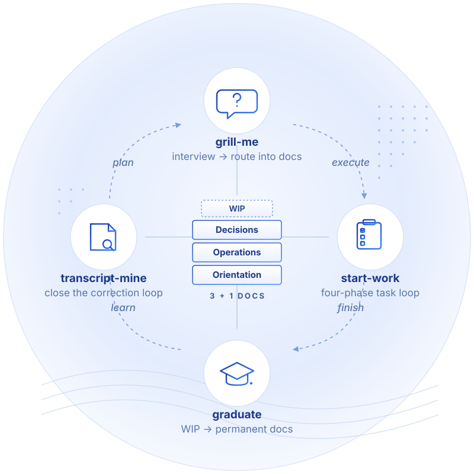

# claude-3plus1-harness

A [Claude Code](https://claude.com/claude-code) **project template**: the 3+1 documentation framework with an executable verification harness and local telemetry, pre-wired. Clone it (or "Use this template"), point one config file at your paths, and a new project starts with docs that grade, a gate that enforces, and a loop that compounds.

Three layers, one premise:

1. **Substrate — the 3+1 docs.** Most engineering knowledge is never published because writing it up is too expensive. If documentation lives in a shape both humans and agents can read, write, and keep current, that cost collapses.
2. **Executor — the verification harness.** In a mature 3+1 project the verification knowledge is already written down; what's missing is the executor. Here the conventions doc is a rubric a grader skill runs, a PreToolUse hook enforces, and a golden set calibrates.
3. **Measurement — local telemetry.** Zero-LLM hooks log the work loop; a SessionEnd harvester preserves session aggregates past transcript rotation; a stdlib script renders the dashboard. The harness does the checking, the telemetry proves it's being used.

Framework reference: [LinkedIn — "Most engineering knowledge is never published"](https://www.linkedin.com/feed/update/urn:li:share:7431585543827668992). Predecessor repo (skills collection + worked examples this template grew out of): [`claude-skills-3plus1`](https://github.com/yurictl/claude-skills-3plus1).

---

## The 3+1 framework, in one screen

| Bucket | Lives in | Holds |
|---|---|---|
| **Orientation** (persistent) | `CLAUDE.md` + optional `LEXICON.md` + optional `CONTRACT.md` at project root | Scope, status, project map; canonical vocabulary; behavioural agreement with the agent |
| **Operations** (persistent) | `docs/operations/` | Runnable procedures with the reference data they need, one topic per file |
| **Decisions** (persistent) | `docs/decisions/` | ADRs / design docs / post-mortems; why a choice was made; append-only or supersede |
| **WIP** (transient) | task tracker (ergo / bd / GitHub Issues / `docs/wip/`) | Hypotheses, investigations, deferred questions — graduate or drop when resolved |

`LEXICON.md` and `CONTRACT.md` are **lazy** — they appear when there is something to write, not before.

---

## What you get

```
CLAUDE.md                          Orientation template — map, severity model, adapter table (TODO slots)
docs/
  operations/conventions.md        the rubric — [BLOCKER]/[WARNING] rules the harness executes
  decisions/ADR-001-*.md           why docs-as-graders (+ anti-tamper / CAVEAT amendment)
  wip/harvest-failure-modes.md     open loop: real failures graduate into the rubric
src/                               placeholder for your product (see scripts/harness.conf)
.claude/
  settings.json                    all hook wiring — harness gate + telemetry (the on/off switch)
  skills/
    review/                        the grader — three bands: [BLOCKER]/[WARNING]/[CAVEAT]
    checkpoint/                    the write-back step — failures become rules + fixtures
    grill-me/                      interview -> route resolutions into the 3+1 buckets
    start-work/                    drive the WIP layer (start / resume / proceed / checkpoint)
    graduate/                      promote finished WIP into Operations / Decisions
    transcript-mine/               close the correction loop from past sessions
scripts/
  harness.conf                     THE file to edit: protected paths, rubric, calibration paths
  grade-marker.sh                  trust anchor: fingerprint-based grade marker (hash/stamp/check)
  hooks/pre-push-grade.sh          the gate: marker integrity + weakened-test + freshness
  replay.sh                        golden-set replay via headless `claude -p`
  hooks/telemetry-log.sh           zero-LLM work-loop event collector
  telemetry_harvest.py             SessionEnd transcript -> durable session aggregate
  telemetry_report.py              console summary / static HTML dashboard
tests/golden/<case>/               case.<ext> + expected.txt (regex the findings must match)
Makefile                           replay / seed-violation / reset + telemetry targets
```

---

## Quickstart

Requirements: `claude` CLI, `git`, `python3`, `bash`.

```bash
git clone <this repo> my-project && cd my-project
rm -rf .git && git init          # or use GitHub's "Use this template"
claude                           # start a session with this dir as project root
```

Then, inside the session:

1. **Seed the docs**: say `grill me` — the interview routes your project's vocabulary, agent contract, procedures, and open questions into the 3+1 buckets, and fills the `TODO` slots in `CLAUDE.md`.
2. **Point the harness**: edit `scripts/harness.conf` (protected paths) and replace the starter rules in `docs/operations/conventions.md` with rules earned from *your* incidents.
3. **Calibrate**: `make replay` — the golden set replays through a headless grader and prints the catch-rate (2/2 out of the box).
4. **See the gate work**: `make seed-violation`, ask Claude to commit and push — the hook blocks; `/review` finds the `[BLOCKER]`; fix, re-review, push. Try `touch .claude/grade-ok` — blocked too.
5. **Work the loop**: `start work` → … → `checkpoint`. Failures the rubric missed become proposed rules + fixtures; finished WIP graduates into permanent docs; `transcript-mine` feeds recurring corrections back into `CLAUDE.md`/`CONTRACT.md`.

---

## The verification harness

The rubric is graded in three bands — `[BLOCKER]`, `[WARNING]`, and `[CAVEAT]`: a justified exception (`# reason:`) that passed the structural check but rests on a semantic assumption, surfaced for human sign-off instead of silently accepted. Caveats are the designed handoff line between harness and human.

The gate is **tamper-aware**, aimed at false completion:

- the grade marker is a **content fingerprint** of the protected paths, not a timestamp — `touch` can't forge it, any post-grade edit (or revert) invalidates it;
- hand edits to the marker are **blocked outright** by the hook;
- a push that changes the product *and* its calibration material (golden set, rubric) in one outgoing set is refused as the **weakened-test pattern** — land calibration changes separately, via `/checkpoint` + `make replay`;
- the replay **discloses uncommitted calibration changes** next to the catch-rate, so a claimed "N/N" always names its baseline.

What stays human by design: `[CAVEAT]` sign-off, stakeholder confirmations, business intent, irreversible operations. The gate frees that attention from re-checking what's already written down.

**Pattern convergence.** [fable-method](https://github.com/Sahir619/fable-method) — a community reconstruction of an agent-verification workflow — independently arrives at the same harness shape, and its domain-adapter triple maps one-to-one onto 3+1: **fraud-patterns** → the rubric + golden set, **evidence** (the source-of-truth probe per check) → Operations, **authority** (who signs off what the harness can't) → `CONTRACT.md`. Cited as convergence, not as measurement.

---

## The four loop skills

<p align="center">
  
</p>

Shipped project-scoped under `.claude/skills/` so a templated project is self-contained; symlink them into `~/.claude/skills/` instead if you want them across all projects.

- **`grill-me`** — interviews you one question at a time and routes every resolution into the right bucket: glossary → `LEXICON.md`, agent-behaviour rules → `CONTRACT.md`, procedures → Operations, costly-to-reverse choices → Decisions, deferred questions → WIP. Adapted from Matt Pocock's `grill-with-docs`.
- **`start-work`** — four phases on whichever tracker the project uses: kick off / resume / proceed autonomously / checkpoint before context is lost. Detects the tracker convention from `CLAUDE.md`; does not invent one.
- **`graduate`** — when a tracked task is verifiably done, move the durable knowledge into Operations / Decisions and close the tracking artifact cleanly. Without it, the WIP layer accretes and the docs surface stays empty.
- **`transcript-mine`** — Eugene Yan's *compounding-loop* practice: scan recent transcripts for recurring corrections, propose config updates. Local only; nothing leaves the machine.

Each skill writes to a layer the next one reads. Skip any of them and the loop leaks: skip `grill-me` and docs stay tacit; skip `graduate` and WIP rots; skip `transcript-mine` and the same correction repeats every session.

---

## Telemetry (optional)

Local observability at 1% of the weight of a real stack — no server, no database, no dependencies. Event log (`.claude/telemetry/events.jsonl`) + session aggregates (`sessions.jsonl`) + `make report` / `make html` for a self-contained dashboard. Collectors always exit 0 (telemetry can never block the agent); stores are local, gitignored, disposable.

Don't want it? Delete the `telemetry-log.sh` and `SessionEnd` entries from `.claude/settings.json` and `scripts/telemetry_*` — the harness is independent of it.

---

## Adapting the template — checklist

- [ ] `scripts/harness.conf` — point `PROTECTED_PATHS` at your product; delete `src/app.conf`.
- [ ] `docs/operations/conventions.md` — replace the starter rules with **incident-earned** rules; generic best practice a frontier model already knows adds nothing.
- [ ] `tests/golden/` — seed from **historical incidents**, one fixture per landed rule; keep `make replay` at N/N.
- [ ] `CLAUDE.md` — fill the `TODO` slots (map, adapter authority/evidence); `grill-me` will walk you through it.
- [ ] Review skills' trigger vocabulary (`telemetry-log.sh` triggers, `start-work` phrases) against your own work-loop language.
- [ ] Check your org's AI-tool policy before moving `scripts/replay.sh` into CI.

## Status

Personal. Lightly polished for sharing, not productised. Successor to [`claude-skills-3plus1`](https://github.com/yurictl/claude-skills-3plus1), where the harness and telemetry first appeared as worked examples.

Origin credits: `grill-me` — adapted from Matt Pocock's `grill-with-docs`; `transcript-mine` — implements Eugene Yan's *closing-the-loop* step from *How to Work and Compound with AI* (2026-05); telemetry — inspired by [agentsview](https://github.com/kenn-io/agentsview); 3+1 framework — mine, written up at the LinkedIn link above.
